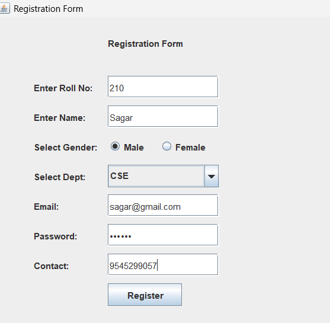
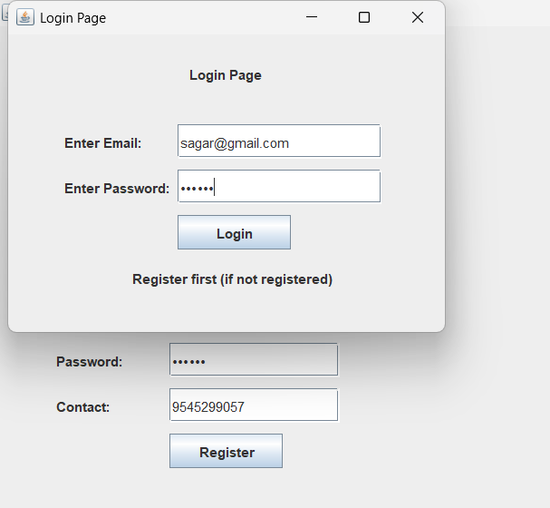
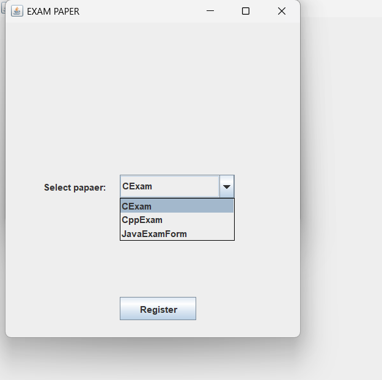
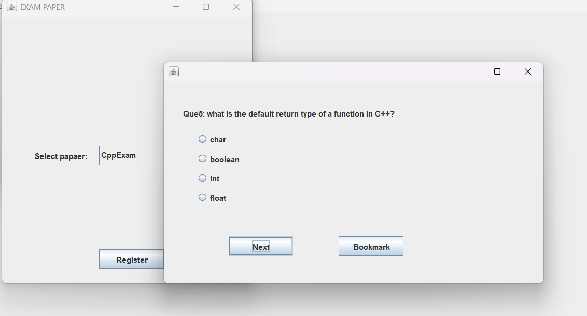
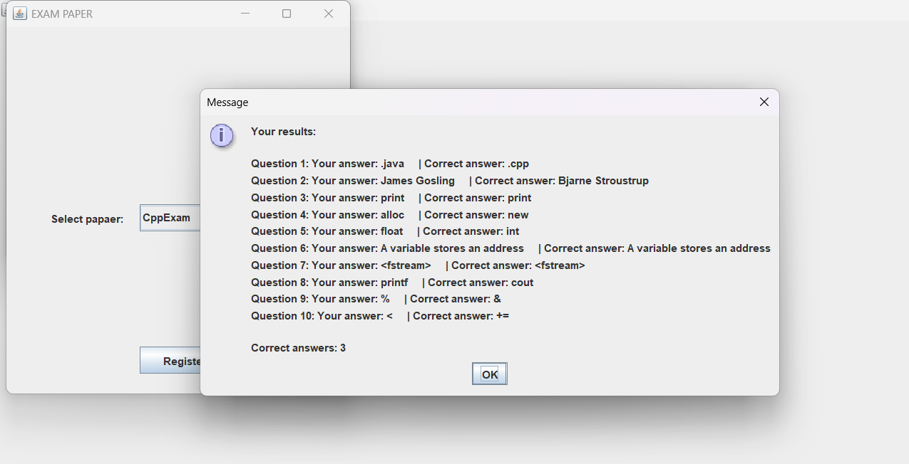
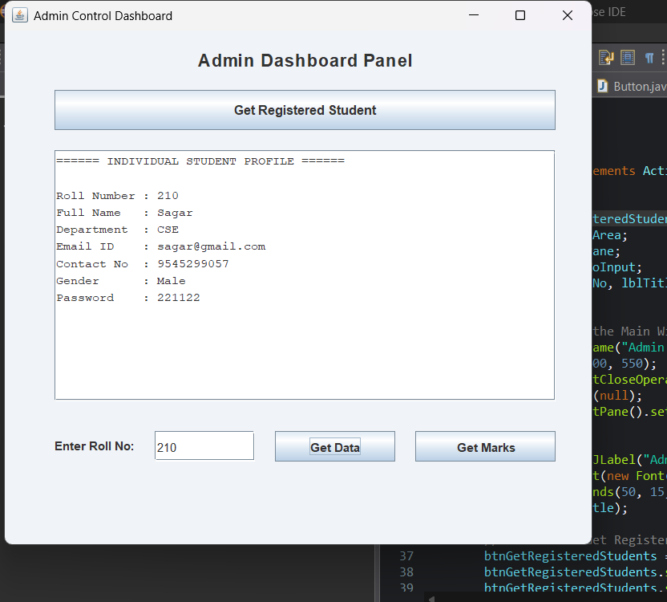
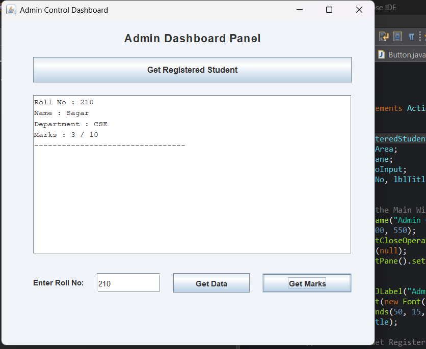

# Online Examination Portal – Java Swing & MySQL

A desktop-based Online Examination Portal developed using Java Swing and MySQL. The application provides student registration, login, subject selection, and examination forms for C, C++, and Java.

## 📌 About the Project

The Online Examination Portal is designed to simplify the process of conducting computer-based examinations. It provides a graphical user interface for students to register, log in, select an examination, and attempt subject-based questions.

**Project Name:** Online Examination Portal  
**Project Type:** Desktop Application  
**Programming Language:** Java  
**GUI Technology:** Java Swing  
**Database:** MySQL  
**Repository:** https://github.com/Sagar-Lokhande-tech/Online-Examination-Portal

## ✨ Features

- Student registration
- Student login interface
- Home screen and examination navigation
- Subject selection for C, C++, and Java
- Separate examination forms for each subject
- MySQL database connectivity
- Student information and examination marks management
- Graphical user interface built with Java Swing

## 🛠️ Technologies Used

| Technology | Purpose |
| --- | --- |
| Java | Application logic |
| Java Swing | Graphical user interface |
| MySQL | Database management |
| JDBC | Java database connectivity, if configured in the project |
| Eclipse IDE | Development environment |
| Git & GitHub | Version control and source code hosting |

## 📂 Project Structure

text
Online-Examination-Portal/
├── Admin.java
├── Home.java
├── Registration.java
├── Login.java
├── SelectPaper.java
├── CExam.java
├── CppExam.java
├── JavaExamForm.java
├── README.md
└── screenshots/
    ├── registration.png
    ├── login.png
    ├── home.png
    ├── select-paper.png
    └── exam.png

# Online Examination Portal — Screenshots

## 1. Registration Page

## 2. Login Page

## 3. Select Paper

## 4. Examination Questions

## 5. Result Page

## 6. Store Data

## 7. Percentage Calculation

Click any screenshot to open the full-size image.

## ⚙️ Requirements

- Java Development Kit (JDK)
- Eclipse IDE or another Java IDE
- MySQL Server
- MySQL Connector/J, if required by the project

## 🚀 How to Run

1. Clone the repository:

   bash
   git clone https://github.com/Sagar-Lokhande-tech/Online-Examination-Portal.git
   

2. Open the project in Eclipse IDE.
3. Configure the JDK and add the required MySQL JDBC driver.
4. Create and configure the MySQL database and tables required by the application.
5. Update database connection settings in the Java source code as needed.
6. Run the registration or main application class according to the project setup.
7. Register a student, log in, and navigate to the examination section.

**Note:** Database credentials, table definitions, and the main entry point must match the actual source code. Never upload database passwords to GitHub.

## 🎯 Learning Outcomes

- Understanding Java object-oriented programming.
- Developing desktop interfaces using Java Swing.
- Connecting Java applications with MySQL.
- Working with student registration and login workflows.
- Organizing a multi-class Java project.
- Managing source code using Git and GitHub.

## 🔮 Future Enhancements

- Add a timer for each examination.
- Calculate and display results automatically.
- Improve input validation and error handling.
- Add an examination history and result dashboard.
- Improve the interface and usability.
- Migrate to a web-based application using Spring Boot.

## 👨‍💻 Author

**Sagar Anil Lokhande**

Aspiring Java Full Stack Developer

- GitHub: https://github.com/Sagar-Lokhande-tech
- Project Repository: https://github.com/Sagar-Lokhande-tech/Online-Examination-Portal

---

If you find this project useful, feel free to explore the repository and share feedback.
